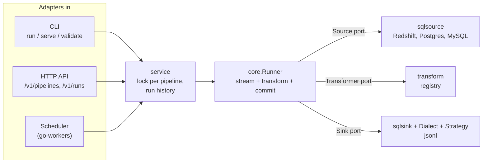
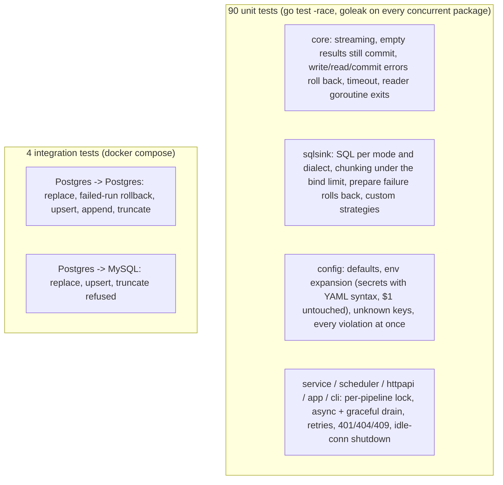

# 🚚 aurora-exporter


**Author:** [Jefferson Marchetti](mailto:jeffersonm.ferreira@gmail.com)

## Overview

A declarative, transactional exporter from Redshift (or any SQL source)
to operational databases: Aurora PostgreSQL, PostgreSQL, Aurora MySQL,
MySQL, or JSON lines. You describe **pipelines** in YAML (a source
query, a target table, a write mode, an optional schedule) and
aurora-exporter runs them on a schedule, from the CLI, or on demand
through an HTTP API.

```yaml
pipelines:
  - name: brands
    source: {connection: redshift, query: "SELECT * FROM rds_mysql.brand_dnb"}
    target: {connection: hotdata, table: rds_mysql.brand_dnb, mode: replace}
    schedule: {every: 1h}
```

This is a rewrite of an internal tool that had one hand-written Go file
per table (21 exporters, entities, sqlc queries and HTTP controllers,
~5k lines). Those 21 exporters are now
[one YAML file](./examples/redshift-to-aurora/aurora-exporter.yaml),
and the rewrite fixed real data-integrity bugs documented in
[`docs/trade-offs.md`](./docs/trade-offs.md): NULLs silently written as
`0`/`false`/`0001-01-01`, a non-transactional DELETE + INSERT that
exposed empty tables to readers, credentials committed in source code.

## Features

- **Any source, any target.** Sources: `redshift`, `postgres`,
  `aurora-postgresql`, `mysql`, `aurora-mysql`. Targets: `postgres`,
  `aurora-postgresql`, `mysql`, `aurora-mysql`, `jsonl`. A new database
  is one `Dialect` (or one `Sink`) plus one registry line, see
  [`docs/design.md`](./docs/design.md#como-adicionar-um-novo-destino).
- **All-or-nothing runs.** Every run is one transaction on the target:
  readers see the previous data until commit, and a failure at row
  2,400,000 changes nothing.
- **Four write modes**: `append`, `replace` (DELETE + INSERT, MVCC-safe
  for readers), `truncate` (faster, locks readers; refused on MySQL
  where TRUNCATE cannot be rolled back), `upsert` (on key columns).
- **Streaming with bounded memory**: batches are read and written
  concurrently, memory is `(prefetch + 1) × batch_size` rows regardless
  of table size; INSERTs are multi-row and sized to the dialect's bind
  parameter limit.
- **Transforms**: `sanitize_utf8` (NUL bytes / invalid UTF-8 that
  PostgreSQL rejects), `rename_columns`, `drop_columns`,
  `lowercase_columns`, pluggable through a registry.
- **Scheduling** through [go-workers](https://github.com/Jeffersonmf/go-workers)
  (retries, panic recovery), with a per-pipeline lock: a pipeline never
  runs twice at once, whether triggered by the scheduler, the API or both.
- **Operable**: graceful shutdown (stop scheduling, drain in-flight runs
  within a deadline, roll back the rest), `/healthz` + `/readyz`
  (pings every database), run history API, structured logs
  (`log/slog`), Bearer-token auth, non-root `FROM scratch` image.
- **Strict config**: unknown keys are errors (`bacth_size` does not
  silently become the default), every violation is reported at once,
  `${VAR}` / `${VAR:-default}` expansion that cannot be broken by
  secrets containing YAML syntax.

## Architecture



`internal/core` holds the domain and the ports (`Source`, `Sink`,
`Transformer`) and imports nothing outside the standard library. Every
technology (drivers, YAML, HTTP, the scheduler) lives in an adapter
that depends on core, never the reverse. `internal/app` is the only
package that knows every concrete type. Details and the SOLID mapping
in [`docs/design.md`](./docs/design.md).

## Quick start

```bash
cp .env.example .env                      # fill in REDSHIFT_DSN, HOTDATA_DSN
cp config/aurora-exporter.example.yaml config/aurora-exporter.yaml
set -a && . ./.env && set +a

make build
./bin/aurora-exporter validate -ping      # config + connectivity
./bin/aurora-exporter run brands          # one pipeline, once
./bin/aurora-exporter run -all            # every enabled pipeline (CronJob-friendly)
./bin/aurora-exporter serve               # scheduler + HTTP API
```

`run` exits non-zero if any pipeline failed and prints a summary:

```text
PIPELINE  STATUS     ROWS  DURATION  ERROR
brands    succeeded  2500  32ms
```

## Commands

| Command    | Purpose                                                               |
|------------|-----------------------------------------------------------------------|
| `serve`    | Scheduler + HTTP API until SIGINT/SIGTERM, then graceful shutdown      |
| `run`      | Run named pipelines (or `-all`) once; exit 1 on failure                |
| `validate` | Check the config and wiring without running; `-ping` tests connectivity |
| `drivers`  | List sources, targets, write modes and transforms                      |
| `version`  | Build information (version, commit, date via `-ldflags`)               |

Every command takes `-config` (default: `$AURORA_EXPORTER_CONFIG`, then
`config/aurora-exporter.yaml`). Logs go to stderr; stdout is reserved
for command output and the `jsonl` stdout sink.

## HTTP API

| Method | Path                         | Description                                   |
|--------|------------------------------|-----------------------------------------------|
| GET    | `/healthz`                   | Liveness                                       |
| GET    | `/readyz`                    | Readiness: 503 if any database is unreachable  |
| GET    | `/version`                   | Build version                                  |
| GET    | `/v1/pipelines`              | Every pipeline, its target, mode and schedule  |
| GET    | `/v1/pipelines/{name}`       | One pipeline                                   |
| POST   | `/v1/pipelines/{name}/runs`  | Start a run: `202` + `Location`, `409` if running |
| GET    | `/v1/runs?pipeline=&limit=`  | Run history, newest first                      |
| GET    | `/v1/runs/{id}`              | One run: status, rows, duration, error         |

With `server.auth_token` set, `/v1` requires `Authorization: Bearer <token>`.

## Configuration

[`config/aurora-exporter.example.yaml`](./config/aurora-exporter.example.yaml)
documents every key. The essentials:

| Key | Default | Notes |
|-----|---------|-------|
| `defaults.batch_size` | 5000 | rows per fetch / write batch |
| `defaults.attempts` | 3 | tries per scheduled tick (1 = no retry) |
| `defaults.timeout` | none | per run; on expiry the run rolls back |
| `defaults.transforms` | none | inherited unless a pipeline sets its own list |
| `pipelines[].target.mode` | `replace` | `append`, `replace`, `truncate`, `upsert` (+ `keys`) |
| `pipelines[].schedule.every` | manual | Go duration, ≥ 1s; the first run happens at startup |
| `pipelines[].enabled` | true | disabled pipelines are not scheduled, nor run by `run -all` |
| `connections.<name>.options.rows_per_statement` | 1000 | rows per INSERT (capped by the bind limit) |
| `server.shutdown_timeout` | 30s | grace period for in-flight runs |

## Verification

```bash
make check             # gofmt, go vet, golangci-lint, go test -race (what CI runs)
make test-integration  # real Postgres -> Postgres and Postgres -> MySQL (docker compose)
```

The integration suite uses a PostgreSQL container as the Redshift
stand-in (Redshift speaks the PostgreSQL wire protocol, so the driver
and code path are the same) and checks, among others: NULLs, numerics,
timestamps, binary and non-ASCII text survive the trip unchanged;
`replace` is idempotent; a run failing on row 2,400 of 2,500 leaves the
previous data intact; `upsert` updates only the selected columns; MySQL
refuses `truncate`.

## Tests



## Docker

```bash
make docker-build   # ~12MB: static binary + CA certificates, FROM scratch, USER 65532
make docker-run     # mounts CONFIG at /etc/aurora-exporter/config.yaml, reads .env
```

## Project structure

```
cmd/aurora-exporter/      main: signal handling, delegates to internal/cli
internal/
  core/                   domain + ports (Source, Cursor, Sink, Writer, Transformer) + Runner
  core/coretest/          in-memory fakes of every port, shared by tests
  connector/sqlsource/    database/sql Source (any driver)
  connector/sqlsink/      database/sql Sink: Dialect (postgres, mysql) x Strategy (4 modes)
  connector/jsonl/        JSON lines Sink (atomic file rename, or stdout)
  connector/builtin/      registers the built-in drivers (the only place importing them)
  registry/               driver name -> Source/Sink factory
  transform/              built-in transformers + registry
  config/                 YAML schema, env expansion, defaults, validation
  run/                    Run model, Recorder/Reader ports, in-memory store
  service/                run-by-name, per-pipeline lock, history
  scheduler/              Scheduler port + go-workers adapter
  httpapi/                HTTP handlers and middleware (stdlib net/http)
  app/                    composition root + serve lifecycle
  cli/                    subcommands
config/                   reference configuration
examples/redshift-to-aurora/   the original 21 exports as config + target migrations
test/integration/         real-database suite (build tag: integration)
docs/                     design.md, trade-offs.md
```

## Roadmap

- `COPY FROM STDIN` fast path for PostgreSQL `append`/`replace`.
- Incremental extraction with a persisted watermark (`updated_at > last_run`).
- Redshift `UNLOAD` to S3 for very large tables.
- Durable run history (`run.Store` in the target database) and Prometheus metrics.

## License

[MIT](./LICENSE)

## Contact

**Jefferson Marchetti**
[jeffersonm.ferreira@gmail.com](mailto:jeffersonm.ferreira@gmail.com)
